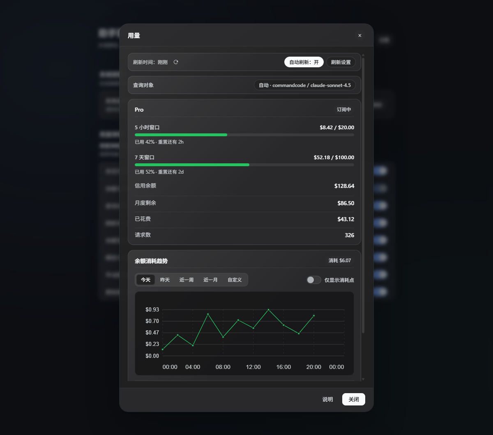
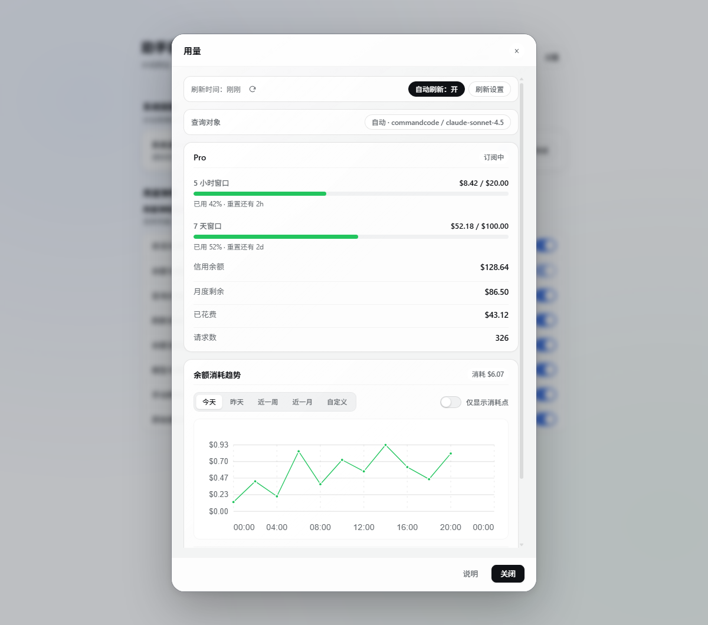
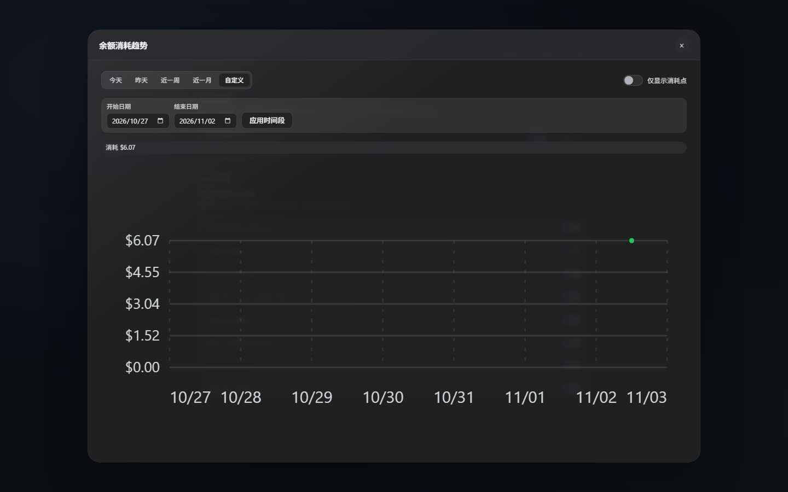
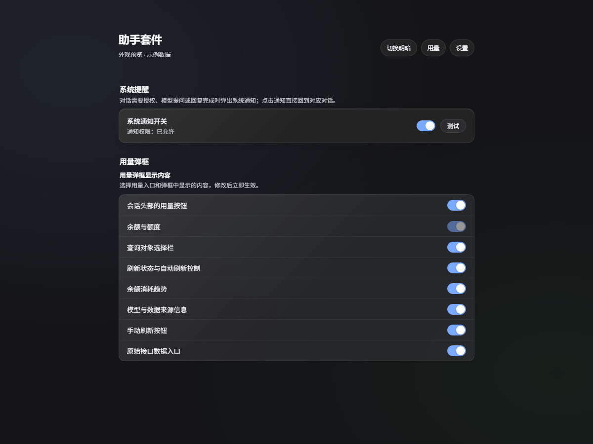

# DSH Assistant Suite

[中文说明](README.md) | English

[](https://www.npmjs.com/package/dsh-assistant-suite)
[](LICENSE)
[](https://nodejs.org/)

The suite combines provider usage queries, balance history, and system notifications for [DeepSeek Harness](https://github.com/deepseek-ai/deepseek-harness). Open **Usage** in a conversation header to inspect the account behind the selected model. Manage notifications and panel display under **Settings → Assistant Suite**.

It combines the features previously provided by `dsh-model-usage` and `dsh-reminding`. When migrating, install and enable the suite, then disable both standalone plugins to prevent duplicate usage entries, routes, or notifications. Existing local preferences and Command Code history are reused when the browser profile and site origin are the same.

Screenshots use sample data. Balances, quotas, and notification permission states shown in them do not represent a real account.



## Features

- **Usage for the current model:** Query the provider account used by the conversation, or choose another configured target without changing the conversation model.
- **Always-on header figure:** The usage button shows the remaining balance or window percentage; hovering lists balance, usage, window progress, and reset countdowns without opening the dialog (on by default, switchable).
- **Sidebar usage ticker:** Scrolls the key numbers of the provider behind the current conversation above Settings, for example "Provider: Command Code Balance: $12.50" (off by default, switchable). It reuses the panel's query and cache.
- **Manual and automatic refresh:** Refresh on demand or on a configurable background interval. A failed refresh keeps the last successful result visible.
- **Command Code balance history:** Collect local samples every ten minutes. Review today, yesterday, recent weeks or months, or a custom date range; clear individual months or reset the account history.
- **System notifications:** Get notified when an action needs approval, the model asks a question, a turn ends, generation fails, or output is truncated. Real notifications link back to their conversation.
- **Unified settings:** Control notification permissions and choose which optional sections appear in the usage panel.
- **Theme and compact layouts:** Follows the host's light or dark theme and adapts to narrow or short windows.

## Requirements

| Component | Requirement |
| --- | --- |
| DeepSeek Harness | `>=0.2.1-rc.2`; the manifest declares compatibility with `0.2.1-rc.2` and `0.2.1-rc.5` |
| Node.js | `>=18` |
| Interface | DSH desktop application or Web interface |
| Notifications | A browser or desktop environment with Notification API support and permission |
| Runtime npm dependencies | None; DSH provides `react` and `react-dom` to the client |

## Install or upgrade

Install and enable `dsh-assistant-suite` from the DSH **Plugins** page. For a profile managed by the CLI:

```sh
dsh plugin --profile <profile> add dsh-assistant-suite
```

For a local checkout:

```sh
dsh plugin --profile <profile> add link:/absolute/path/to/dsh-assistant-suite
```

Confirm that the bundle is enabled in the Plugins page, then reload the interface. If the host does not support hot reload, restart it. Profiles managed by the desktop application should be changed through the Plugins page. Running `npm install` only downloads the package; it does not enable the plugin in DSH.

Disable the standalone `dsh-model-usage` and `dsh-reminding` plugins after enabling the suite. On the same browser profile and site origin, the suite can continue using the old plugins' refresh settings, query target, history, and notification preference. Suite-specific panel display settings use a separate storage key.

## Provider usage

Click **Usage** in the conversation header. By default, the query follows the current conversation model. Use **Query target** to select another provider route; this does not change the model used for the conversation. Credentials are read by the host through the provider's credential reference.

| Provider or route | Reported information |
| --- | --- |
| Command Code | Plan, five-hour and seven-day windows, credit balance, spend, request count, balance history |
| DeepSeek API | Account balance by currency |
| Signed-in DeepSeek account | Wallet balance through the host account service; no API key required |
| OpenCode Go | Per-model quota windows, as returned by its endpoint |
| OpenRouter | Key usage, limit, remaining amount, and account credit pool when available |
| Moonshot / Kimi | Available, cash, and voucher balances |
| SiliconFlow | Total, charged, and granted balances |
| New API and other OpenAI-compatible routes with `baseURL` | `/api/user/self` quota balance, usage, total, and account or request details when provided |

Usage belongs to the provider account, so different models using the same credential may share a balance or quota. The New API adapter converts the `quota` and `used_quota` fields returned by `/api/user/self`; a `baseURL` such as `https://host/prefix/v1` supports deployments behind a reverse-proxy path. Other OpenAI-compatible services work only when they implement the same endpoint and fields. The OpenCode Go adapter also depends on endpoint conventions and may not work with every compatible service. OpenCode Zen pay-as-you-go routes do not have a supported usage adapter.

### Custom usage templates

A service outside the built-in adapters can describe its usage endpoint with a template. There are two places to put one:

- **Settings page (recommended, editable any time)**: open **Settings → Assistant Suite → Custom usage templates** and fill one in per provider that already has a key. Templates saved there stay in the current browser, travel with that provider's query, and win over the provider-configuration template.
- **Provider configuration (shipped with the config)**: for example `llm-pi-ai.providers.<id>.usageTemplate`; the host picks it up after a reload.

#### Steps

1. Store the provider's API key in **Settings → Models**; the template uses that route's credential reference, shown in the settings page.
2. Expand the provider under **Custom usage templates** and click **Set template**. Start from a preset (Command Code, One API / New API, OpenRouter, Moonshot / Kimi, SiliconFlow, DeepSeek official, or the generic blank template), or click **Initialize from the built-in adapter** to turn the endpoint and fields this plugin already uses into an editable template.
3. Edit the JSON. The editor previews the resolved request URL live (the key is masked as `***`) and checks JSON validity, same-origin rules, the method, and placeholders.
4. Click **Test template**: the draft is sent for real. Success lists the fields the panel would show; failure shows the host's own error (HTTP status, origin rule, extraction failure). Testing never saves.
5. Click **Save template**, then refresh the usage panel. Removing a template falls back to the built-in adapter.

#### Template shape

| Field | Required | Meaning |
| --- | --- | --- |
| `request.url` | yes | Endpoint. Supports the placeholders below; its host must match the provider `baseURL`. |
| `request.method` | no | `GET` (default) or `POST`. |
| `request.headers` | no | Name → value; values support placeholders. Without `Authorization` the host adds `Bearer {{apiKey}}`. |
| `request.body` | no | POST only; a JSON object or string with placeholders, sent as `application/json` unless a `Content-Type` is set. |
| `extractor` | one of | Synchronous `function (response, ctx) { ... }`; `response` is the parsed JSON, `ctx` is `{ now, baseUrl }`. |
| `extract` | one of | Declarative field paths, e.g. `{ remaining: 'data.quota' }`. |

Placeholders:

| Placeholder | Resolves to |
| --- | --- |
| `{{baseUrl}}` | The configured `baseURL` with trailing slashes removed |
| `{{baseUrlRoot}}` | That URL without a trailing `/v1`-style version segment (cc-switch's `.replace(/\/v1$/, "")`) |
| `{{origin}}` | Protocol plus host (`https://host[:port]`) |
| `{{apiKey}}` | The provider key; percent-encoded in URLs, literal in headers and bodies |

`extractor` result:

| Field | Meaning |
| --- | --- |
| `remaining` / `used` / `total` | Remaining, used, total; numbers or numeric strings. A missing side is derived from the other. |
| `unit` | Currency symbol, default `USD`; `¥`, `CNY`, and similar are accepted. |
| `planName` / `account` / `totalCount` | Plan, account, request count (optional). |
| `windows` | `[{ label, used, limit, resetsAt }]`, rendered as quota meters. |
| `isValid` | `false` with no figures reports the key as rejected. |
| A bare number | Treated as `remaining`. |

Example (balance, endpoint returns `{ "data": { "balance": "12.50", "currency": "CNY" } }`):

```json
{
  "request": { "url": "{{baseUrlRoot}}/v1/balance", "method": "GET" },
  "extractor": "function (response) { return { remaining: response?.data?.balance, unit: response?.data?.currency ?? 'CNY' } }"
}
```

Example (windows, endpoint returns `{ "five_hour": { "used": 12, "limit": 100, "reset_at": 1767225600 } }`):

```json
{
  "request": { "url": "{{baseUrlRoot}}/v1/usage", "method": "GET" },
  "extractor": "function (response) { return { windows: [{ label: '5 hours', used: response?.five_hour?.used, limit: response?.five_hour?.limit, resetsAt: (response?.five_hour?.reset_at ?? 0) * 1000 }] } }"
}
```

Declarative form (field paths, no script):

```yaml
usageTemplate:
  url: '{{baseUrlRoot}}/api/user/self'
  extract:
    remaining: data.quota
    used: data.used_quota
    totalCount: data.request_count
    unit: USD
```

#### Common errors

| Message | Cause / fix |
| --- | --- |
| `HTTP 401` / `403` | Wrong credential for that provider, or the endpoint wants different headers; set them under `request.headers`. |
| `HTTP 404` | Wrong `request.url` path; try `{{baseUrlRoot}}` plus the real path. |
| `用量地址的域名要和供应商 baseURL 一致` | The template targets another host; the key is deliberately not sent there. |
| `模板没有取到余额、已用或总额` | The extractor's field names or `extract` paths do not match the payload; run the test to see the raw answer. |
| `接口返回 isValid=false，密钥可能无效` | The endpoint reports `isValid: false` or the like; check whether the key is revoked or expired. |
| `extractor 只能是同步函数` | An `async` function or Promise was used; compute synchronously. |
| Timeout | The endpoint did not answer within one second (template) or 30 seconds (whole request). |

Limits: the response must be JSON; the URL must stay on the provider host; the extractor is synchronous with a one-second deadline and has no `process`, `require`, or network access.

The Command Code credit balance and its five-hour or seven-day windows are separate values. The suite displays provider-returned data; it does not infer a monthly total quota from a remaining credit balance.

## Refresh and data freshness

- Automatic refresh is enabled by default and runs every five minutes. Choose 1, 5, 15, 30, or 60 minutes, or enter 1–1440 minutes.
- The session component queries when the model changes. While automatic refresh is enabled, it continues on its interval even when the panel is closed.
- Use the refresh icon beside the update time to query immediately. It is disabled while a request is in progress.
- Opening the panel checks for stale data even when background refresh is disabled.
- On failure, the panel retains the previous successful result and marks the error. A first-query failure shows an error and retry action.



## Balance history

Balance history currently supports Command Code. While the session component is running, the suite samples on each ten-minute clock mark (`:00`, `:10`, `:20`, and so on), independently of the panel refresh setting. Samples are stored locally per account for the current calendar month and the previous two months. Time when the application is closed is not backfilled, and clearing site data also removes the local history.

Open the chart for a larger view. Select a date range, including a custom start and end date, then apply it. Short ranges show actual sample times; week, month, and longer custom ranges are grouped by day. History can be cleared by month or reset for the current account.



## Notifications and display settings

Open **Settings → Assistant Suite** to manage system notifications, test notification delivery, and choose optional sections in the usage panel. The balance and quota section is always shown; **Balance next to the usage button** defaults to on, and **Provider and balance at the sidebar bottom** defaults to off.

| Event | Notification |
| --- | --- |
| A tool waits for approval | An approval reminder; requests answered automatically shortly after are filtered |
| The model asks a question or requests plan review | A reminder that a response or review is needed |
| A turn ends | A completion reminder; closely spaced turns are grouped |
| Generation fails or output is truncated | A failure or output-limit reminder |

When an approval or question is handled, its notification is dismissed. Subagent sessions do not send separate notifications. Notifications are suppressed while the page is focused on the same conversation. Click **Test** to grant permission when needed and verify delivery. Test notifications only check delivery and window focus; they do not open a conversation.



## Data and permissions

Provider queries run in the host process. The browser receives normalized usage, the credential reference name, and the data source; credential values stay in the host. Queries access the corresponding provider API. Notifications use a local host route, which checks browser request trust through the host connection service.

Refresh preferences, manual query target, history, and display settings are stored in browser `localStorage` and scoped to the browser profile and site origin. Notifications use committed session events and do not modify session content. The host notification module also writes local loading and window-focus diagnostics to `lib/dsh-reminding-debug.log`; this log is not included in the npm package.

## Troubleshooting

**Usage or Assistant Suite settings are missing.** Confirm that the suite is enabled and reload the interface. If the usage entry was hidden in display settings, enable it again.

**Notifications do not appear.** Check the suite notification switch and permission, use **Test**, then check operating-system notification permissions, banners, and Do Not Disturb settings. A browser also needs an origin where notification permission can be granted.

**A balance query fails.** Check the query target and the provider credential and address under **Settings → Models**. Some OpenAI-compatible services do not expose account usage endpoints. Read the error shown in the panel.

**No history is visible.** History currently supports Command Code and needs time to collect samples. Data is not synchronized when changing browser profiles, site origins, or after clearing site data.

**Duplicate usage entries or notifications appear.** Disable the standalone `dsh-model-usage` and `dsh-reminding` plugins, and check for other plugins that provide the same notifications.

## Development and publishing

The project has no npm runtime dependencies. Build and checks use Node.js built-in capabilities. The two feature client sources are combined into one browser entry: after editing `lib/model-usage.client.js` or `lib/reminding.client.js`, rebuild the generated `lib/client.js` instead of editing it directly.

```sh
npm run build:client   # Rebuild the combined client
npm test               # Build, package checks, host tests, and client tests
npm run pack:check     # Preview npm package contents
npm run verify         # Test and check package contents
npm pack               # Create a local .tgz package
```

Before publishing, update the version and `CHANGELOG.md`, run `npm run verify`, and review the package contents. Publish from an npm account with package access:

```sh
npm login
npm publish
```

`publishConfig` selects the public npm registry. `prepublishOnly` runs tests, and `prepack` rebuilds the client and checks the package configuration.

## License and links

This project is licensed under the [MIT License](LICENSE), Copyright © 2026 liuchaoxu. It is an independent community plugin and is not affiliated with or endorsed by DeepSeek.

- [GitHub repository](https://github.com/liuchaoxu/dsh-assistant-suite)
- [Report an issue](https://github.com/liuchaoxu/dsh-assistant-suite/issues)
- [npm package](https://www.npmjs.com/package/dsh-assistant-suite)
