# DSH Assistant Suite · 助手套件

[English](README.en.md) | 中文

[](https://www.npmjs.com/package/dsh-assistant-suite)
[](LICENSE)
[](https://nodejs.org/)

为 [DeepSeek Harness](https://github.com/deepseek-ai/deepseek-harness) 提供**模型供应商用量查询、余额消耗趋势和系统提醒**。将 `dsh-model-usage` 与 `dsh-reminding` 合并为一个插件，在会话头部查看用量，在 **设置 → 助手套件** 统一管理通知和面板显示。

当前版本：`0.2.0`。支持深浅色主题、磨砂玻璃面板和窄屏布局，中英文随应用语言切换。本文截图使用示例数据展示界面，余额、额度与通知权限状态不代表实际账户情况。

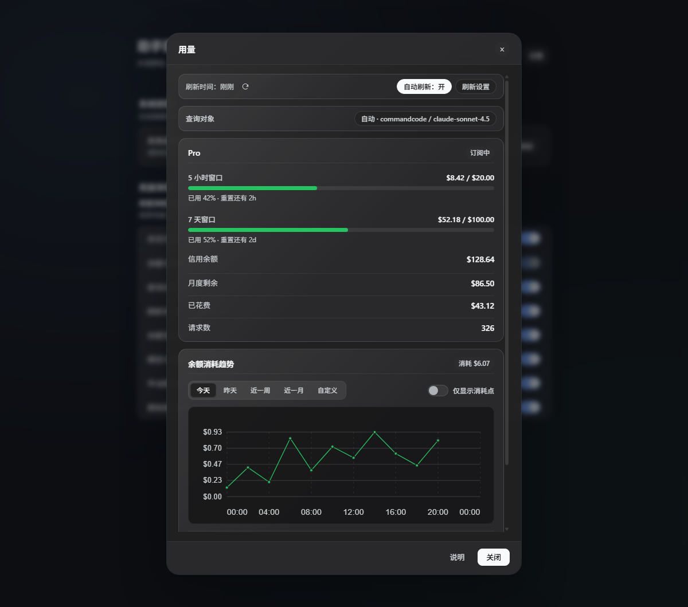

## 功能

- **跟随会话模型**：查询当前模型对应供应商账户的余额、额度窗口与请求数；也可手动选择查询对象，不改变会话使用的模型。
- **头部常驻数字**：会话头部的「用量」按钮直接显示剩余余额或窗口百分比，hover 显示余额、已用、窗口进度与重置倒计时，不用先打开弹窗（默认开启，可在设置关闭）。
- **侧栏用量滚动条**：在左下角 Settings 上方滚动显示当前会话所用供应商的关键数字，例如「供应商：Command Code 余额：$12.50」（默认关闭，可在设置开启）；数据复用同一查询与缓存。
- **Token 与成本**：按天、供应商、模型统计对话产生的请求数、输入/输出/缓存读取 token；单价按「供应商 / 模型」设置（同一模型在不同供应商下可分别定价），可一键填 DeepSeek 参考价，编辑时实时显示每个模型和合计的预计花费。
- **手动与自动刷新**：时间右侧的刷新图标可立即查询，查询中暂时禁用。支持后台定时刷新；失败时保留上次成功的数据并显示错误。
- **余额消耗趋势**：Command Code 账户按时间采样，支持今天、昨天、近一周、近一月、自定义日期，以及按月清理和重置记录。
- **独立趋势弹框**：点击图表打开大图，日期控件与图表按可用空间布局；矮窗口支持滚动，坐标轴保持完整。
- **系统提醒**：需要授权、模型提问、回合完成、生成失败或输出截断时提醒，点击真实通知返回对应会话。
- **统一设置**：管理通知开关、权限测试，以及用量入口、刷新状态、历史趋势、数据来源等显示选项，修改立即生效并保存在本机。
- **主题适配**：使用宿主的深浅色配色，提供磨砂背景和柔和高光；支持减少动画、减少透明效果的系统偏好，不支持背景模糊时使用实色面板。

## 环境要求

| 项目 | 要求 |
| --- | --- |
| DeepSeek Harness | `>=0.2.1-rc.2`；清单声明兼容 `0.2.1-rc.2`、`0.2.1-rc.5` |
| Node.js | `>=18` |
| 界面 | DSH 桌面应用或 Web 界面 |
| 系统通知 | 浏览器或桌面环境支持 Notification API，并允许通知 |
| npm 运行时依赖 | 无；客户端的 `react`、`react-dom` 由 DSH 提供 |

## 安装与升级

### 插件页面

在 DSH 的 **Plugins / 插件** 页面安装 `dsh-assistant-suite` 并启用。npm 包发布后可按包名安装；本地开发可通过插件管理工具的 `install_bundle` 将目标指向项目目录。

安装后重新加载界面。若宿主未启用热更新，重启应用以加载主机端代码。桌面应用管理的 profile 请通过插件页面安装和启用。

### CLI

对于允许 CLI 管理的 profile：

```sh
dsh plugin --profile <profile> add dsh-assistant-suite
```

本地目录安装：

```sh
dsh plugin --profile <profile> add link:/absolute/path/to/dsh-assistant-suite
```

安装后在插件页面确认已启用。单独执行 `npm install` 只下载 npm 包，不会自动在 DSH 中启用插件。

### 从旧插件迁移

安装并启用本套件后，停用原来的 `dsh-model-usage` 和 `dsh-reminding`，避免重复的用量入口、提醒及相同路由注册。套件保留旧功能的本地存储键；在相同浏览器配置及站点来源下，原有刷新设置、查询对象、历史记录和提醒开关可继续读取。用量显示选项使用套件独立的存储键。

## 查看供应商用量

点击会话头部的 **用量**。默认跟随当前会话模型，点击 **查询对象** 可手动切换，密钥始终由宿主按供应商自己的凭据引用读取。

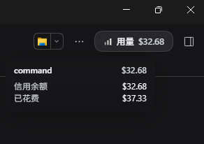

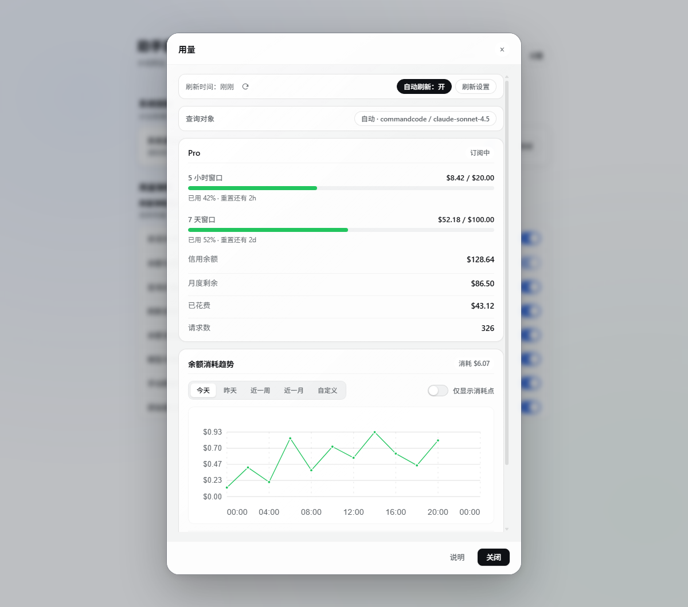

当前适配来源：

| 供应商 / 路由 | 主要显示内容 |
| --- | --- |
| Command Code | 套餐、5 小时 / 7 天额度、信用余额、已花费、请求数、余额消耗趋势 |
| DeepSeek API | 按币种的账户余额 |
| DeepSeek 登录账户 | 通过宿主账户服务读取钱包余额，无需 API Key |
| OpenCode Go | 按模型的额度窗口；依据接口返回字段显示 |
| OpenRouter | Key 已用、额度、剩余，以及可获得的账户额度池 |
| Moonshot / Kimi | 可用余额、现金余额、代金券 |
| SiliconFlow | 总余额、充值余额、赠送余额 |
| New API 路由及其他带 `baseURL` 的 OpenAI 兼容路由 | 查询 `/api/user/self`，显示额度余额、已用、总额，以及接口提供的账户名和请求数 |

用量属于供应商账户，多个模型使用同一个凭据时可能共享余额或额度。New API 适配按其 `/api/user/self` 响应中的 `quota` 和 `used_quota` 字段换算余额；如部署在反向代理子路径下，配置的 `baseURL` 可使用 `https://host/prefix/v1` 形式。其他 OpenAI 兼容服务仅在实现相同接口和字段时可查询。OpenCode Go 适配同样依赖接口约定，无法保证所有兼容服务均可查询。OpenCode Zen 按量计费路由没有对应适配，不应与 OpenCode Go 混淆。

### 自定义用量模板

内置适配之外的服务，可以给它的用量接口写一个模板。两种放置方式：

- **设置页（推荐，随时改）**：打开 **设置 → 助手套件 → 第三方用量模板**，为每个已配置密钥的供应商单独填写。模板只存在当前浏览器，查询该供应商时随请求发给宿主，优先于供应商配置里的模板。
- **供应商配置（可随配置分发）**：写在供应商配置下，例如 `llm-pi-ai.providers.<id>.usageTemplate`，保存后重新加载宿主生效。

#### 配置步骤

1. 先在 **设置 → 模型** 里填好该供应商的 API Key；模板用的是该路由的凭据引用，设置页会显示它的名字。
2. 在 **第三方用量模板** 里展开对应供应商，点 **设置模板**。可以从「从预设开始」里选 Command Code、One API / New API、OpenRouter、Moonshot / Kimi、SiliconFlow、DeepSeek 官方或通用空模板；也可以点 **用内置适配初始化**，把插件当前使用的接口和字段直接生成成模板，再按实际返回修改。
3. 编辑 JSON。编辑器会实时显示 **请求预览**（解析后的 URL，密钥显示为 `***`），并检查 JSON、同源、方法和占位符。也可以直接粘贴 cc-switch 的 `{ request, extractor }` 写法（含 `function` 和 `.replace(...)` 拼接的 URL），粘贴时会自动转换。
4. 点 **测试模板**：用当前草稿真实请求一次，成功时列出将要显示的字段，失败时给出宿主原始报错（HTTP 状态、同源限制、提取失败等）。测试不会保存。
5. 点 **保存模板**，回到用量面板刷新即可看到结果；移除模板会退回内置适配。

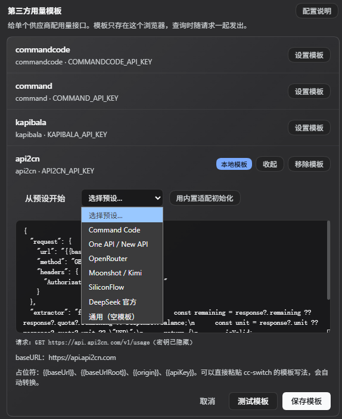

#### 模板结构

| 字段 | 必填 | 说明 |
| --- | --- | --- |
| `request.url` | 是 | 接口地址。支持下面的占位符；域名必须与供应商 `baseURL` 相同。 |
| `request.method` | 否 | `GET`（默认）或 `POST`。 |
| `request.headers` | 否 | 请求头键值对，值支持占位符。未写 `Authorization` 时自动附加 `Bearer {{apiKey}}`。 |
| `request.body` | 否 | 仅 POST；JSON 对象或字符串，占位符会替换，未写 `Content-Type` 时自动补 `application/json`。 |
| `extractor` | 二选一 | 同步函数 `function (response, ctx) { ... }`；`response` 是接口 JSON，`ctx` 是 `{ now, baseUrl }`。 |
| `extract` | 二选一 | 声明式写法：字段路径映射，如 `{ remaining: 'data.quota' }`。 |

占位符：

| 占位符 | 替换为 |
| --- | --- |
| `{{baseUrl}}` | 供应商配置的 `baseURL`（去掉结尾斜杠） |
| `{{baseUrlRoot}}` | `baseURL` 去掉结尾的 `/v1`、`/v2` 等版本段，等价于 cc-switch 的 `.replace(/\/v1$/, "")` |
| `{{origin}}` | 协议 + 域名（`https://host[:port]`） |
| `{{apiKey}}` | 该供应商的密钥；URL 中百分号编码，请求头和 body 中原文 |

`extractor` 返回值：

| 字段 | 说明 |
| --- | --- |
| `remaining` / `used` / `total` | 剩余、已用、总额；数字或数值字符串。缺一侧会按另一侧推算。 |
| `unit` | 币种符号，默认 `USD`；也接受 `¥`、`CNY` 等。 |
| `planName` / `account` / `totalCount` | 套餐名、账户名、请求数（可选）。 |
| `windows` | `[{ label, used, limit, resetsAt }]`，渲染为额度窗口进度条。 |
| `isValid` | 为 `false` 且没有数字时，面板直接提示密钥无效。 |
| 纯数字 | 视为 `remaining`。 |

示例（余额型，接口返回 `{ "data": { "balance": "12.50", "currency": "CNY" } }`）：

```json
{
  "request": { "url": "{{baseUrlRoot}}/v1/balance", "method": "GET" },
  "extractor": "function (response) { return { remaining: response?.data?.balance, unit: response?.data?.currency ?? 'CNY' } }"
}
```

示例（窗口型，接口返回 `{ "five_hour": { "used": 12, "limit": 100, "reset_at": 1767225600 } }`）：

```json
{
  "request": { "url": "{{baseUrlRoot}}/v1/usage", "method": "GET" },
  "extractor": "function (response) { return { windows: [{ label: '5 小时', used: response?.five_hour?.used, limit: response?.five_hour?.limit, resetsAt: (response?.five_hour?.reset_at ?? 0) * 1000 }] } }"
}
```

声明式写法（只取字段，不跑脚本）：

```yaml
usageTemplate:
  url: '{{baseUrlRoot}}/api/user/self'
  extract:
    remaining: data.quota
    used: data.used_quota
    totalCount: data.request_count
    unit: USD
```

#### 常见错误

| 提示 | 原因 / 处理 |
| --- | --- |
| `HTTP 401` / `403` | 该供应商的凭据不对，或接口需要不同的请求头（在 `request.headers` 里显式写）。 |
| `HTTP 404` | `request.url` 路径不对；用 `{{baseUrlRoot}}` 加实际路径再试。 |
| `用量地址的域名要和供应商 baseURL 一致` | 模板写到了别的主机；密钥不会外发。 |
| `模板没有取到余额、已用或总额` | `extractor` 返回的字段名对不上接口，或 `extract` 路径写错；先点测试看原始返回。 |
| `接口返回 isValid=false，密钥可能无效` | 接口返回 `isValid: false` 或类似字段，检查该 Key 是否被封或过期。 |
| `extractor 只能是同步函数` | 用了 `async` 或 Promise；改成同步计算。 |
| 超时 | 接口 1 秒内没返回（模板执行）或 30 秒（整个请求）。 |

限制：响应必须是 JSON；只能请求供应商同域地址；`extractor` 同步执行、上限 1 秒；沙箱里没有 `process`、`require` 和网络。

### 刷新与数据时效

- 默认开启自动刷新，间隔 **5 分钟**；预设 1、5、15、30、60 分钟，也可输入 **1–1440 分钟**。
- 挂载的会话组件会在模型切换时查询，自动刷新开启时，即使弹框关闭也会按间隔查询。
- **刷新时间** 右侧的图标手动刷新数据；刷新中禁用以避免重复请求。隐藏刷新状态栏后，手动刷新入口保留在详情底部。
- 打开弹框时，过期数据会重新查询；即使关闭后台自动刷新，打开的面板仍会检查数据是否过期。
- 刷新失败保留上次成功数据并标记错误，首次查询失败则显示错误及重试入口。

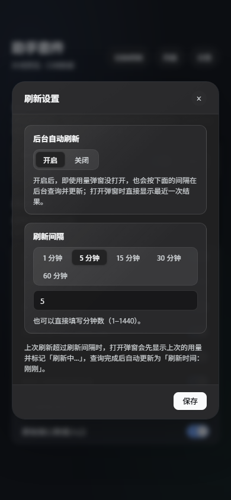

## 余额消耗趋势

此功能目前针对 **Command Code**。会话组件运行期间，按系统时钟每十分钟的整点（`:00`、`:10`、`:20` 等）采样，与面板自动刷新开关独立。记录按账户保存在浏览器本地，保留当前自然月和前两个月；关闭应用期间不会补采数据，清除浏览器站点数据会同时清除本地历史。

点击图表可放大查看，选择 **自定义** 后填写开始和结束日期，再点击 **应用时间段**。短时间范围按实际采样时间显示，近一周、近一月及较长自定义范围按日汇总；可切换 **仅显示消耗点**，也可在用量面板按月份清理记录或重置当前账户记录。

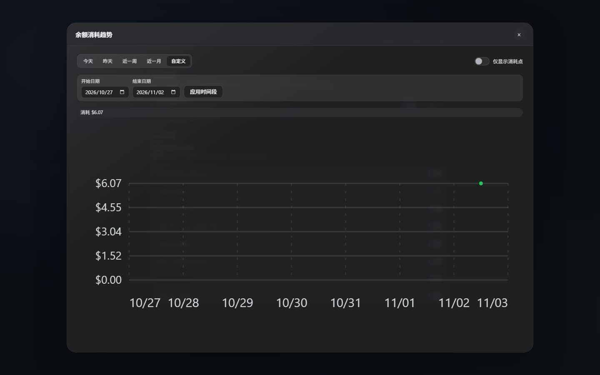

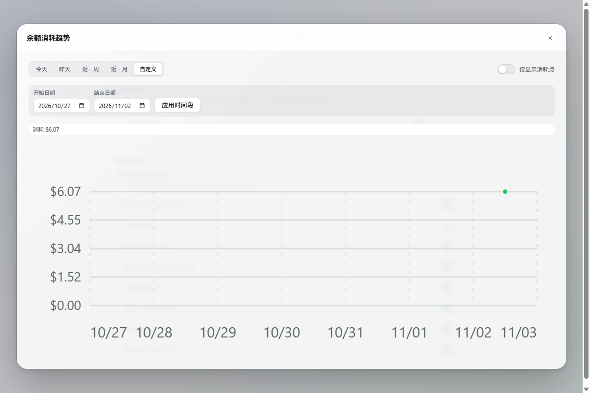

## 系统提醒与显示设置

打开 **设置 → 助手套件**。上方管理系统通知与测试，下方选择用量弹框的显示内容。**余额与额度** 是固定保留的核心内容，其余项目可按需显示或隐藏；**用量按钮旁显示余额** 默认开启，**左下角显示供应商与余额** 默认关闭。

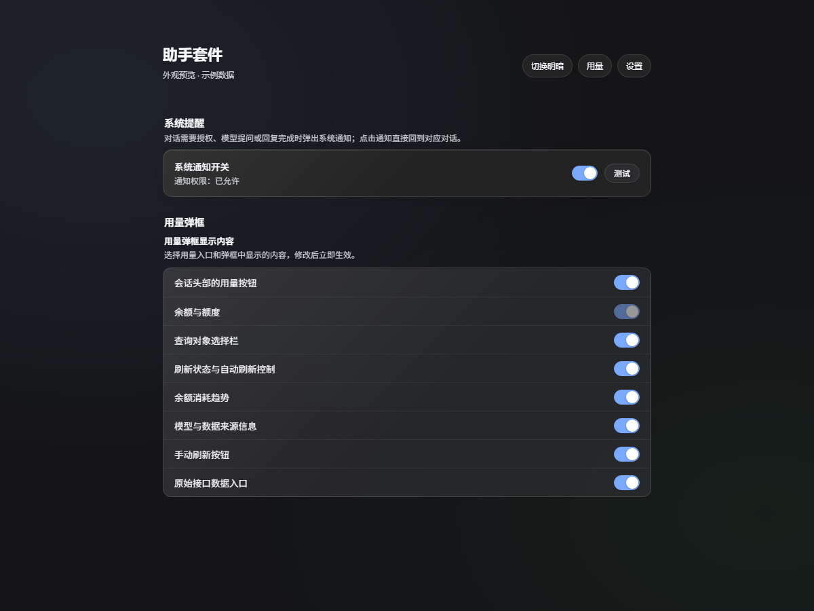

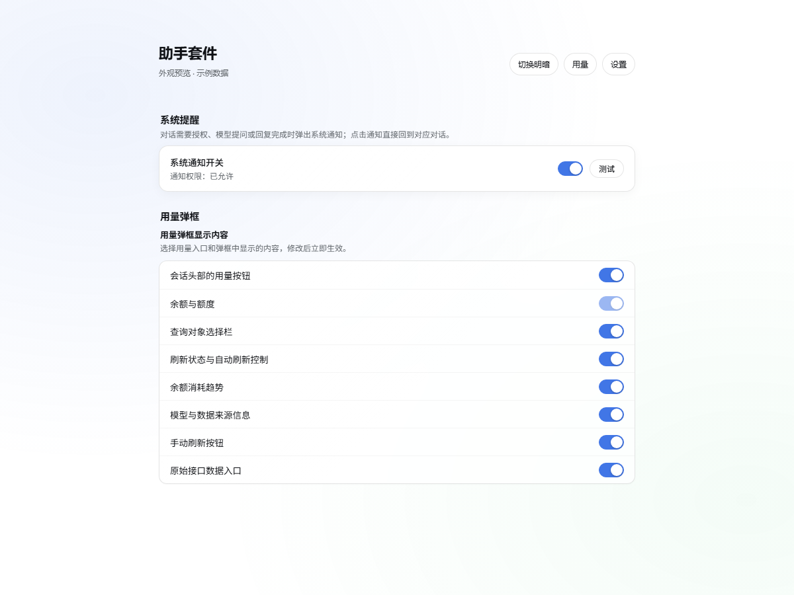

| 提醒时机 | 行为 |
| --- | --- |
| 工具等待授权 | 提醒需要授权；短时间内自动处理的请求会被过滤 |
| 模型提问 / 计划审阅 | 提醒等待回答或审阅 |
| 回合完成 | 提醒本轮回复结束，短时间连续轮次会合并处理 |
| 生成失败 / 输出截断 | 提醒失败或达到输出长度上限 |

授权或提问被处理后，对应通知会关闭；子代理会话不单独提醒。页面处于前台且正在查看同一会话时会抑制通知，避免打扰。

首次使用时点击 **测试** 完成权限授权并验证通知。真实通知带有会话信息，点击后尝试将窗口切到前台并打开对应对话；测试通知只用于验证通知和聚焦窗口，不跳转会话。

## Token 用量与费用

插件启用后在宿主侧累计 `assistant/message` 事件中的输入、输出、缓存读取 Token 数及请求数，按日期、供应商和模型汇总，提供最近 30 天的明细。此统计不会回溯启用前的请求，也不会把不同供应商的同名模型合并计价。

在用量面板的 **Token 与费用** 区域，可按供应商/模型填写输入、输出和缓存读取单价（每百万 Token），也可填入 DeepSeek 参考单价。费用按当前价格即时计算；历史请求使用当前配置的单价重新估算。清空单价后仍保留 Token 统计，但不显示费用。

统计和价格表保存在 `$DSH_HOME/assistant-suite/usage-ledger.json`；可用 `DSH_ASSISTANT_LEDGER` 指定文件路径。该文件属于本机宿主数据，不会同步到浏览器或随插件包发布。

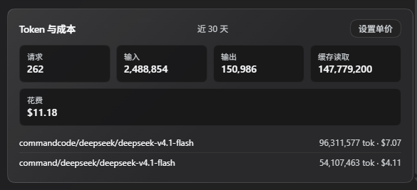

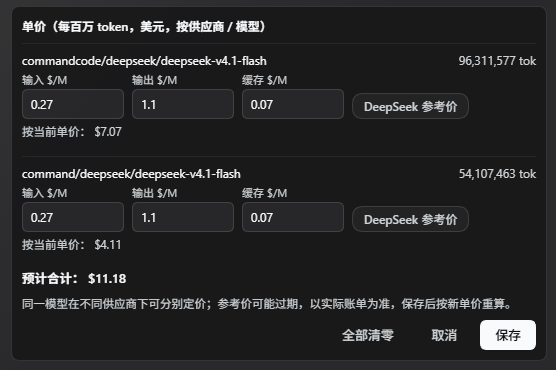

## 窄屏与矮窗口

下面的截图分别展示窄屏用量、设置和趋势视图，以及矮窗口下可滚动的趋势布局。

| 窄屏用量 | 窄屏设置 |
| --- | --- |
| 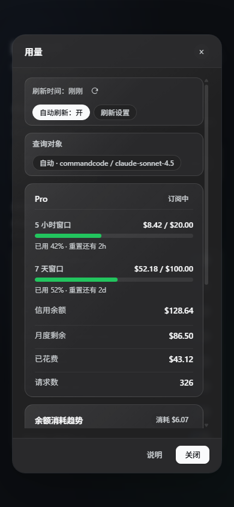 | 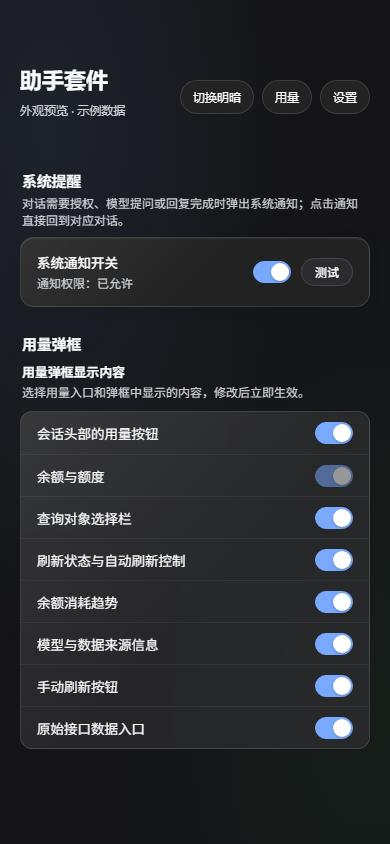 |

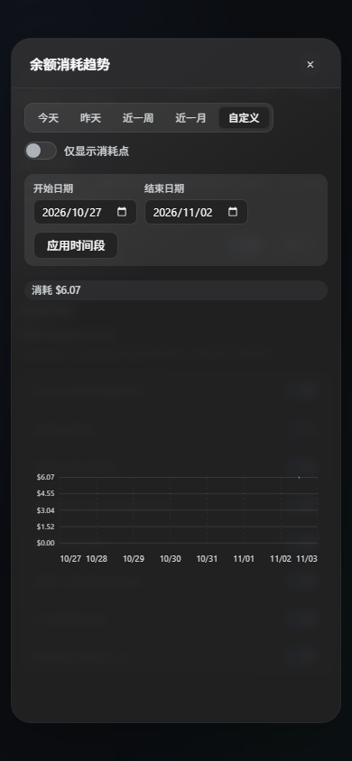

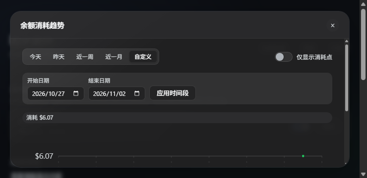

## 数据与权限

供应商查询在宿主进程执行，浏览器接收归一化用量、凭据引用名和来源，不接收密钥值。查询会访问相应供应商 API；提醒通过宿主本地路由传递。相关路由使用宿主连接服务检查浏览器请求的信任状态。

刷新策略、手动查询对象、历史记录和显示开关保存在浏览器 `localStorage`，按浏览器配置及站点来源隔离。提醒根据已提交的会话事件生成，不修改会话内容。当前主机端提醒模块还会在 `lib/dsh-reminding-debug.log` 写入本地加载与窗口聚焦诊断信息，该日志不包含在 npm 发布包内。

## 常见问题

**没有用量入口或助手套件设置？** 确认插件已启用并重新加载界面；如果在显示设置中隐藏了用量入口，重新开启即可。

**收不到通知？** 先在助手套件设置中检查通知开关和权限，点击测试；再检查操作系统对 DSH 或浏览器的通知权限、横幅设置和勿扰模式。浏览器还需要可授予通知权限的站点环境。

**余额查询失败？** 检查查询对象，以及 **设置 → 模型** 中对应供应商的凭据与地址。并非每个 OpenAI 兼容服务都提供账户用量接口；失败时查看面板中的具体错误。

**看不到历史趋势？** 当前仅支持 Command Code，并且需要在本地积累采样。切换浏览器、站点来源或清空站点数据后，旧浏览器中的记录不会自动同步。

**出现重复用量按钮或重复提醒？** 检查原来的两个独立插件是否仍然启用，也检查其他通知插件是否同时提供相同提醒。

## 开发与 npm 发布

仓库不需要安装 npm 运行时依赖，检查与测试使用 Node 内置能力。两份功能客户端源码合成为一个浏览器入口：修改 `lib/model-usage.client.js` 或 `lib/reminding.client.js` 后，执行构建；不要直接修改生成的 `lib/client.js`。

```sh
npm run build:client   # 重新生成合并客户端
npm test               # 构建、包检查、Host 测试、Client 测试
npm run pack:check     # 预览 npm 打包文件（也会执行打包前构建与检查）
npm run verify         # 测试并检查打包内容
npm pack               # 生成本地 .tgz 安装包
```

主要目录：

```text
lib/index.js                  Host 合并入口
lib/model-usage.js             供应商用量查询
lib/reminding.js               系统提醒事件与本地路由
lib/model-usage.client.js      用量客户端源码
lib/reminding.client.js        提醒与设置客户端源码
lib/client.js                  生成的合并客户端
locale/                       插件管理页中英文元数据
docs/screenshots/             按功能、主题和显示场景命名的截图
scripts/                      构建、包检查与功能测试
cordis.patch.yml              assistant-suite bundle 注册行
LICENSE                       MIT 协议全文
```

发布前更新版本和 `CHANGELOG.md`，执行 `npm run verify`，确认打包内容后，在拥有包发布权限的 npm 账户下执行：

```sh
npm login
npm publish
```

`publishConfig` 已指定 npm 官方 registry 和公开访问；`prepublishOnly` 自动运行测试，`prepack` 自动重建客户端并检查包配置。包内包含主机端、生成的客户端及其源码、构建与检查脚本、locale、图标、截图、文档和 MIT 许可证；本地日志、缓存、编辑器文件不在发布白名单内。

## English

DSH Assistant Suite combines provider-account usage and system reminders for DeepSeek Harness. Open **Usage** in a conversation header to inspect balances and quota windows, refresh beside the updated time, or select a different query target without changing the conversation model. Command Code spending history supports custom dates and a larger scrollable chart dialog.

Manage notification permissions, test notifications, and choose visible panel sections under **Settings → Assistant Suite**. Real notifications return to their conversation; test notifications only test delivery and focus. The interface follows the host's language and light/dark appearance. Screenshots above use sample data.

Requires DeepSeek Harness `>=0.2.1-rc.2` and Node.js `>=18`. Install `dsh-assistant-suite` from the DSH plugin page once published, or use the CLI command above for a CLI-managed profile. Disable the standalone `dsh-model-usage` and `dsh-reminding` plugins when using the suite. No runtime npm dependencies are required; DSH supplies React and React DOM. Run `npm run verify` before publishing.

## 协议与链接

本项目采用 [MIT License](LICENSE)，Copyright © 2026 liuchaoxu。你可以按 MIT 条款使用、修改和分发，并保留原版权与许可声明。这是独立社区插件，与 DeepSeek 无隶属或背书关系。

- [GitHub 仓库](https://github.com/liuchaoxu/dsh-assistant-suite)
- [反馈问题](https://github.com/liuchaoxu/dsh-assistant-suite/issues)
- [npm 包页面](https://www.npmjs.com/package/dsh-assistant-suite)（发布后可用）
